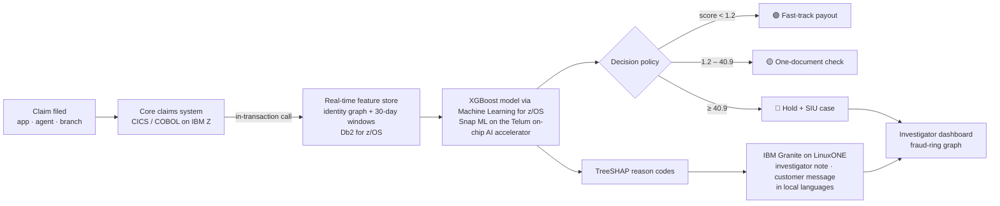

# 🛡️ ClaimGuard: real-time AI risk scoring for insurance claims on IBM Z

> **Pay honest claims in hours. Stop fraudulent ones before the money leaves.**
> IBM Z Datathon 2026 · Theme 1: Real-time AI on transactional data

Fraudulent and inflated claims are one of the largest leakages for insurers, and honest customers pay twice: through higher premiums and through weeks of waiting while every claim is checked by hand. ClaimGuard scores **every claim the instant it is filed**, inside the claims transaction, and routes it to one of three lanes:

| Lane | What happens | Test-set share |
|---|---|---|
| 🟢 **Fast-track** | Paid straight through, no manual work | **37%** of claims (only 3% of fraud slips in) |
| 🟡 **Quick document check** | Customer is asked for one extra document in-app | 59% |
| 🔴 **Investigate** | Payout held, Special Investigation Unit gets an explained case | **4%** of claims, **77% hit-rate** |

Every decision comes with **exact reason codes** (TreeSHAP) and a plain-language note written by **IBM Granite**, so investigators know what to check, and customers are never accused by a machine.

---

## Results (time-based hold-out: the most recent 12,000 claims)

| Metric | Value |
|---|---|
| ROC-AUC | **0.907** |
| PR-AUC | **0.659** (random = 0.067, so ~10× better than chance) |
| Fraud **value** stopped before payout | **99.2%** (₹14.78 Cr of ₹14.91 Cr) |
| Investigator hit-rate (precision) | **76.7%** |
| vs. hand-written red-flag rules, same alert volume | **81% vs 62% of fraud caught** (+30%) |
| Recall by scheme (not fast-tracked) | rings 100% · early-policy 100% · phantom 99% · provider billing 97% · inflation 97% |
| Scoring latency (laptop, ONNX Runtime) | **~0.2 ms p50** per claim |
| ONNX vs native model parity | max \|Δp\| = 3e-7 |

## Architecture



**How it works**

1. **Stream.** Each claim event arrives from the core claims system (simulated feed here: `claimguard/stream.py`).
2. **Real-time features** (`claimguard/features.py`): 26 features computed in microseconds from state that existed *before* the claim:
   - *Claim facts:* amount vs actuarial tariff, share of sum insured, policy age, reporting delay, incident hour, police report / pre-authorisation, documents, channel.
   - *Identity graph:* customers linked through shared phone numbers / bank accounts (union-find), which exposes organised rings.
   - *Rolling 30-day windows:* per garage/hospital and per agent (claim spikes, billing level, late-night share, share of claims from linked groups).
3. **Predict.** A gradient-boosted tree model (XGBoost). On IBM Z, tree models are served through **Machine Learning for z/OS / IBM Snap ML** on the Telum on-chip AI accelerator. We also export **ONNX** for portability; neural-network variants would be compiled with the IBM Z Deep Learning Compiler.
4. **Decide.** Thresholds are set by business policy on the validation set: fast-track only where ≥97% of fraud is still caught, and investigate where precision is ≥80%.
5. **Explain.** TreeSHAP gives exact per-claim reason codes. **IBM Granite** (watsonx.ai or local) rewrites them into an investigator note in English, Hindi, Tamil, Bengali or Marathi. GenAI never changes the score.

The **same** `build_features → observe` code path is used for training (replaying history in time order) and live scoring, so there is **no train/serve skew and no future leakage**.

## IBM Z integration

> ✅ **Running live on IBM LinuxONE (s390x):** trained, tested (6/6) and served on a real LinuxONE virtual server, with dashboard on port 80 and API on port 8000. See [`deploy/ibmz/README.md`](deploy/ibmz/README.md#-live-deployment-ibm-linuxone-s390x-rhel-98) for how the stack was built on s390x and the big-endian fixes.

| Capability | Why it matters for ClaimGuard |
|---|---|
| **Telum on-chip AI accelerator (NNPA)** | Scores 100% of claims inside the transaction with no network hop; Telum is built for exactly this. |
| **Machine Learning for z/OS** | Deploys the ONNX model and exposes in-transaction scoring to CICS/COBOL claims apps. |
| **IBM Z Deep Learning Compiler (zDLC)** | Path for deep-learning ONNX models (e.g. a future neural variant); compile script in `deploy/ibmz/`. |
| **Db2 for z/OS** | Hosts the feature store next to the claims records, so customer data never leaves the platform. |
| **Pervasive encryption + Crypto Express HSM** | Encrypts health and financial data at rest and in flight with no application changes. |
| **IBM Secure Execution / Hyper Protect (LinuxONE)** | Runs the Granite explanation service and dashboard in enclaves that even admins can't read. |
| **IBM Snap ML** | Drop-in accelerated training on LinuxONE; exports to the same ONNX contract. |

See [`deploy/ibmz/README.md`](deploy/ibmz/README.md) for the step-by-step deployment path (LinuxONE Community Cloud and z/OS).

## Quick start

```bash
./run.sh setup        # creates .venv and installs requirements (uses uv if available)
./run.sh train        # generates 60k claims, trains, evaluates, exports ONNX (~10 s)
./run.sh dashboard    # http://localhost:8501
```

Optional:

```bash
./run.sh api                          # REST service on :8000 (docs at /docs)
./run.sh stream --rate 20 --limit 200 # replay live claims against the API
./run.sh test                         # 6 smoke tests
```

**GenAI notes with IBM Granite** (falls back to a deterministic template if not configured):

```bash
# watsonx.ai
export CLAIMGUARD_LLM=watsonx WATSONX_APIKEY=... WATSONX_PROJECT_ID=... WATSONX_URL=https://us-south.ml.cloud.ibm.com
# or local (ollama pull granite3.3:2b)
export CLAIMGUARD_LLM=ollama
```

> macOS note: XGBoost needs OpenMP. `run.sh` uses the copy bundled with scikit-learn automatically; alternatively `brew install libomp`.

### Demo script (dashboard)

1. **📡 Live claims** → ▶ Start feed. Claims stream in and get scored in ~0.2 ms; watch the fast-track share and the payout held.
2. **🔍 Investigate** → pick a 🔴 claim, then read its reason codes and click *Generate investigator note (IBM Granite)*.
3. **📝 File a claim** → submit **Priya** (genuine fender-bender → fast-track), then **Rahul** (9-day-old policy, linked to a ring → investigate).
4. **🕸️ Fraud rings** → the identity graph: linked customers funnelling claims into one garage.
5. **📊 Model & IBM Z** → metrics, rules-vs-AI comparison, and the IBM Z deployment map.

## Data methodology

Real claims are confidential, so `claimguard/data.py` simulates an Indian insurer's motor + health claim feed (60,000 claims, 42,000 customers, 680 garages/hospitals, 300 agents, one year). The fraud mechanisms follow publicly documented red flags (IRDAI, Insurance Information Bureau of India, NICB):

- opportunistic **inflation** · **early-policy** claims · **phantom** claims with weak paperwork
- **provider billing** fraud by colluding garages/hospitals
- organised **rings** sharing phones/bank accounts, staging late-night incidents through the same provider and agent, clustered in time

To keep it honest, distributions **overlap**: genuine customers also file on new policies, report late, or share a family phone, and 0.5% label noise mimics imperfect investigation outcomes. The evaluation uses a strict **time-based split** (70% train / 10% validation for thresholds / 20% test), never a random shuffle.

**Next step with real data:** the pipeline is schema-driven, so plugging in an insurer's historical claims (or public sets such as the Kaggle auto-insurance-claims data) only requires mapping columns in `features.py`.

## Responsible AI

- **Human in the loop:** the model never rejects a claim. High risk means a human investigator decides.
- **Explainable by design:** exact TreeSHAP reason codes for every decision, which supports IRDAI expectations on fair claim handling.
- **No accusatory messages:** customers get neutral, helpful messages; GenAI only rephrases facts and cannot change a decision.
- **Privacy by design:** features use phone/bank *linkage*, not raw identities in the model; on IBM Z all data stays encrypted on-platform.
- **No protected attributes** (gender, religion, caste) are collected or used. Age and tenure are monitored for disparate impact before production.
- **Policy-driven thresholds** are set by business rules (max fraud leak, min investigator precision), not hidden inside the model.

## Repository layout

```
claimguard/
  data.py        synthetic claims + fraud-scheme simulator
  features.py    real-time entity store (identity graph, rolling windows) + features
  train.py       time-ordered replay, XGBoost training, policy thresholds, ONNX export
  scorer.py      live scoring engine: features → ONNX → decision → reason codes
  explain.py     TreeSHAP reason text + IBM Granite notes (watsonx / Ollama / template)
  api.py         FastAPI scoring service (the integration contract)
  stream.py      replays the live period against the API
dashboard/app.py Streamlit investigator dashboard
deploy/ibmz/     LinuxONE services + live-deployment notes, Dockerfile, z/OS integration notes, zDLC script
artifacts/       model.json, claimguard.onnx, metadata.json (metrics)
docs/            submission answers, video script, pitch deck
tests/           smoke tests
```

## Open-source resources

XGBoost · scikit-learn · ONNX · onnxmltools · ONNX Runtime · FastAPI · Streamlit · Plotly · NetworkX · pandas · NumPy · IBM Granite · IBM Z Deep Learning Compiler. Links are in [`docs/SUBMISSION.md`](docs/SUBMISSION.md).
